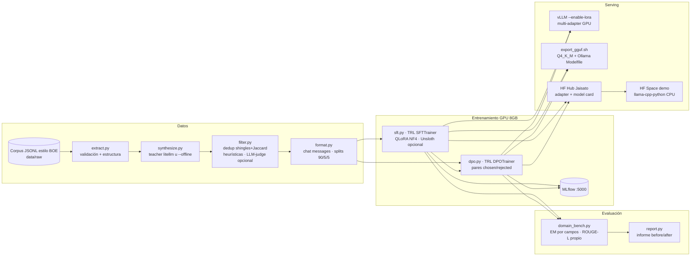

# AdapterForge

> **Fábrica reproducible de adapters LoRA/QLoRA en una GPU de consumo de 8 GB.**
> Dataset instruccional sintético anclado a normativa española → SFT QLoRA (TRL/PEFT,
> Unsloth opcional) → alineamiento DPO → evaluación before/after con benchmark propio →
> serving en tres formatos (vLLM multi-LoRA, GGUF/Ollama, HF Hub). Todo dockerizado
> (WSL2 + CUDA), con tracking MLflow y publicación automática por GitHub Actions.

Proyecto 2 del portfolio de IA aplicada de [Jairo Sarabia](https://github.com/jaisato)
· Código en [github.com/jaisato/adapterforge](https://github.com/jaisato/adapterforge)
· Modelos y datasets en [huggingface.co/Jaisato](https://huggingface.co/Jaisato)
(ver [Resultados](#resultados--juristune-v6) y [Datos](#datos-corpus-boe-y-datasets-juristune))

---

## ¿Qué es?

AdapterForge implementa el ciclo completo que las ofertas de AI Engineer llaman
"fine-tuning eficiente" y que casi nadie enseña de punta a punta: **construir el
dataset, entrenar el adapter, evaluarlo con honestidad y servirlo de forma
operable**, en hardware de consumo y de forma reproducible por cualquier revisor.

El caso de uso es **JurisTune**: un adapter que especializa un modelo base en
redacción y comprensión jurídico-administrativa española (resúmenes estructurados,
Q&A con cita verificable `[BOE-A-2026-XXXX, art. N]`, extracción de
obligaciones/plazos/sanciones en JSON y lenguaje llano).



## Resultados — JurisTune v6

**v6** es el adapter final (sexta iteración del dataset y del entrenamiento;
las anteriores quedaron congeladas como `configs/qlora_qwen3-4b_v*.yaml` y
`juristune-v*` en el Hub). Entrenado con `configs/qlora_qwen3-4b_v6.yaml`:
QLoRA r=16/alpha=32 sobre los 7 módulos de atención y MLP de
`Qwen/Qwen3-4B-Instruct-2507`, dataset `juristune-v6` (4 024 train / 225 val /
226 test, split por documento), seq_len 2048, lr 1e-4, 2 épocas con early
stopping por `eval_loss`, Unsloth activo. En la GPU de 8 GB tardó 2 h 59 min
(504 pasos; loss de entrenamiento 1.266 → 0.008, `eval_loss` final 0.023).
Fuente: [`evals/results/v6/train_metrics.json`](evals/results/v6/train_metrics.json)
y [`train_experiment.json`](evals/results/v6/train_experiment.json), copiados
del `artifacts/qlora_qwen3-4b-v6/` del run del 2026-08-25 (el `git_sha`
`e8cb16a` que registran pertenece al historial anterior a la purga de ficheros
grandes; en el historial actual la v6 corresponde a `a5c3af2`…`4fbfbe0`).

Benchmark de dominio [`evals/domain_bench_v2.jsonl`](evals/domain_bench_v2.jsonl)
(111 casos con referencia: 44 `extract`, 36 `qa`, 31 `resumen`). Base y
adapters servidos como GGUF Q4_K_M en el Ollama local con el mismo `TEMPLATE`
y los mismos `PARAMETER`; temperatura 0, **3 generaciones por caso** (el score
del caso es la media) y los cuatro modelos **intercalados en la misma sesión**
(2026-08-29):

| Modelo (Q4_K_M) | extract (EM por campos) | qa (containment / ROUGE-L) | resumen (ROUGE-L) | **overall** |
|---|---:|---:|---:|---:|
| Base `Qwen3-4B-Instruct-2507` | 1.000 | 0.819 | 0.637 | **0.840** |
| JurisTune v4 | 0.955 | 0.947 | 0.734 | 0.891 |
| JurisTune v5 | 1.000 | 0.934 | 0.716 | 0.899 |
| **JurisTune v6** (publicado) | **1.000** | **0.922** | **0.726** | **0.898** |

- **v6 − base**: delta medio pareado por caso **+0.058** (SD 0.240, SE 0.023,
  n=111), IC 95 % (+0.014, +0.103): el IC excluye 0. 14 casos regresan de
  forma robusta (rangos de las 3 repeticiones disjuntos): 11 `resumen` y
  3 `qa`, listados caso a caso en el informe. v5 y v6 empatan en overall
  (0.899 frente a 0.898); v6 es el adapter final del proyecto.
- **Fuente**: [`evals/results/v6/report_final_v6.md`](evals/results/v6/report_final_v6.md),
  generado con `python -m adapterforge.eval.report` a partir de los
  `results.json` de [`evals/results/v6/bench-v2-final/`](evals/results/v6/bench-v2-final/)
  (incluyen las tres predicciones crudas de cada caso y los parámetros de
  generación). Las puntuaciones se recalcularon con la métrica actual tras la
  corrección de `618db9f` (containment por tokens completos) y no cambia
  ningún caso. Un segundo run solo base-vs-v6 (`make eval-pair`, misma mañana)
  dio 0.840 → 0.898 con IC 95 % (+0.013, +0.104).
- **Límites**: métricas deterministas (EM/containment/ROUGE-L) sin juez
  humano ni LLM; n=111 casos de un solo benchmark propio; la regresión en
  `resumen` sobre varios casos es real y el IC es ancho. No es asesoramiento
  jurídico.

Para reproducir la tabla (GPU para entrenar/exportar, Ollama para servir):

```bash
make data-pull                                  # corpus BOE + juristune-v6_* desde HF
make train-v6                                   # SFT QLoRA v6 (~3 h en 8 GB)
bash serve/export_gguf.sh Qwen/Qwen3-4B-Instruct-2507 \
  artifacts/qlora_qwen3-4b-v6/adapter artifacts/gguf-v6   # merge + GGUF Q4_K_M + Modelfile
ollama create juristune-v6-eval -f artifacts/gguf-v6/Modelfile
# La base se cuantiza igual (pasos 2-4 del script sin adapter) y se registra como
# qwen3-base-2507-eval con un Modelfile renderizado por render_modelfile.
make eval-pair BASE_MODEL=qwen3-base-2507-eval ADAPTER_MODEL=juristune-v6-eval
cat artifacts/eval/report_pair.md
```

## Arquitectura y decisiones

- **Núcleo ligero, entrenamiento pesado aislado**: el paquete `adapterforge`
  (datos, configs, métricas) solo depende de pydantic/yaml/httpx/litellm; torch,
  transformers, trl, peft, datasets, mlflow y unsloth viven en grupos opcionales
  y se importan de forma perezosa. Puedes construir y filtrar datasets en
  cualquier máquina sin GPU.
- **Configuración como contrato**: cada experimento es un YAML validado con
  pydantic (`ExperimentConfig`). Las combinaciones inviables en 8 GB
  (`seq_len*batch` excesivo) se rechazan antes de importar torch; el resto de
  riesgos emite avisos suaves con estimación de VRAM.
- **Modo offline de la síntesis**: generadores determinísticos producen el
  dataset de muestra (40 ejemplos SFT + 15 pares DPO incluidos en el repo) sin
  API ni red — el smoke-train y los tests no dependen de ningún proveedor.
- **Evaluación con dos niveles**: métricas deterministas propias (exact-match
  por campos, ROUGE-L) para el gate de CI, y juez LLM opcional para rúbricas.
- **Serving dual**: vLLM `--enable-lora` (GPU, multi-adapter) y GGUF/Ollama
  (CPU/edge). Ver decisiones completas en `docs/adr/`:
  - [ADR 0001 — QLoRA + Unsloth opcional vs full fine-tuning](docs/adr/0001-qlora-unsloth-vs-full-finetune.md)
  - [ADR 0002 — DPO vs ORPO](docs/adr/0002-dpo-vs-orpo.md)
  - [ADR 0003 — GGUF/Ollama vs vLLM-LoRA para servir](docs/adr/0003-gguf-ollama-vs-vllm-lora.md)

## Requisitos

- **Windows 11 + WSL2 (Ubuntu 24.04)** con `wsl --update` reciente.
- **Driver NVIDIA de Windows** (nunca instalar un driver Linux dentro de WSL:
  el driver de Windows ya expone CUDA a WSL2).
- **Docker Engine dentro de WSL2** + `nvidia-container-toolkit`. Verificación:

  ```bash
  docker run --rm --gpus all nvidia/cuda:12.4.1-base-ubuntu22.04 nvidia-smi
  ```

- **Python 3.12** y `make` para el flujo local sin contenedor (datos/eval/tests).
- **GPU NVIDIA de 8 GB de VRAM** (el entrenamiento usa NF4 + gradient
  checkpointing). Recomendado: `.wslconfig` con `memory=48GB`, `swap=16GB`, y el
  repositorio clonado en el filesystem de Linux (`~/proyectos/...`, no `/mnt/c/`).

### Presupuesto de VRAM y matriz de fallback OOM

| Situación | Config recomendada | VRAM aprox. |
|---|---|---|
| Smoke/CI | `SmolLM2-360M`, seq 512, batch 2 | ~2 GB |
| **Cómodo (por defecto)** | `Qwen3-4B`, seq 1024, batch 1, accum 16 | ~3.7-5 GB |
| Alternativa | `Llama-3.2-3B`, seq 1024, batch 1 | ~3-4.5 GB |
| Stretch (con Unsloth) | `Qwen3-8B`/`Llama-3.1-8B`, seq 1024, batch 1, accum 16 | ~6-7.5 GB |

**Si aparece OOM, aplica en este orden** (cada paso es un cambio en el YAML):

1. Reduce `seq_len` (1024 → 768 → 512): las activaciones escalan lineal.
2. Asegura `batch_size: 1` y sube `grad_accum` para mantener el batch efectivo.
3. Instala **Unsloth** en la imagen de entrenamiento (descomenta la línea en
   `docker/Dockerfile.train`): ahorra 1-2 GB y acelera.
4. Baja a un modelo menor (8B → 4B → 3B) o reduce `lora.r` (16 → 8).
5. Último recurso: cierra procesos que ocupen VRAM (Ollama del host, navegador).

La validación de `ExperimentConfig` te avisará antes de tocar la GPU si la
combinación pinta mal (`vram_warnings`), y rechazará en duro lo imposible.

## Puesta en marcha local paso a paso

```bash
# 1) Clonar DENTRO del filesystem de WSL2
git clone https://github.com/jaisato/adapterforge.git ~/proyectos/adapterforge
cd ~/proyectos/adapterforge

# 2) Entorno del núcleo (datos/eval/tests; sin GPU)
python3.12 -m venv .venv && source .venv/bin/activate
pip install -e ".[dev]"
cp .env.example .env          # rellena tokens solo si vas a usar teacher/HF

# 3) Verificar calidad
make lint && make test

# 4) Generar el dataset de muestra (modo offline, sin API)
make data                      # escribe data/processed/{sample_sft,sample_dpo}.jsonl y splits

# 5) Construir la imagen de entrenamiento y lanzar el smoke (GPU)
docker compose --profile train build trainer
make train-smoke               # 30 pasos; métricas en artifacts/smoke/metrics.json
python scripts/check_smoke.py artifacts/smoke/metrics.json

# 6) Entrenamiento real + tracking
make mlflow                    # UI en http://localhost:5000
make train                     # configs/qlora_qwen3-4b.yaml
make dpo                       # fase DPO sobre los pares de preferencia
```

> Síntesis con teacher real (opcional): sustituye el paso offline por
> `python -m adapterforge.data.synthesize --input data/interim/documents.jsonl \
> --output data/interim/sft_raw.jsonl --model openai/gpt-4o-mini` (o
> `--backend openai --api-base http://host.docker.internal:11434/v1 --model qwen3:8b`
> para un teacher 100 % local vía Ollama).

## Datos: corpus BOE y datasets JurisTune

Los JSONL generados superan el límite de 100 MB por fichero de GitHub, así que
no se versionan (`.gitignore`: `data/raw/corpus_boe.jsonl`,
`data/processed/juristune*.jsonl`). Viven en el dataset **privado**
[`Jaisato/juristune-datasets`](https://huggingface.co/datasets/Jaisato/juristune-datasets)
con la misma disposición de carpetas que este repositorio:

| Fichero en el Hub | Contenido | Tamaño |
|---|---|---:|
| `data/raw/corpus_boe.jsonl` | 872 disposiciones reales del BOE (API de datos abiertos) en formato `RawDocument`, descargadas con `scripts/fetch_boe_corpus.py` | 79 MB |
| `data/processed/juristune-v6_{train,val,test}.jsonl` | **Dataset v6 canónico**: 4 024 / 225 / 226 ejemplos `messages` + `meta`, split por documento; síntesis offline + ejemplos `qa` del teacher `qwen2.5:7b-instruct` filtrados con juez LLM | 16 MB |
| `data/processed/juristune-v{2,2b,3,4,5}_{train,val,test}.jsonl` | Iteraciones anteriores, congeladas con el código de su época | 16–536 MB cada una |
| `data/processed/juristune_{train,val,test}.jsonl` | v1 (3 986 ejemplos de entrenamiento) | 409 MB |
| `data/processed/juristune_dpo.jsonl` | 1 500 pares de preferencia offline (v1) | 139 MB |

Descarga (requiere un token de **lectura** con acceso al dataset: `HF_TOKEN`
o `AF_HF_TOKEN` en el entorno/`.env`, o la sesión de `hf auth login`):

```bash
pip install -e ".[hub]"                  # huggingface_hub
make data-pull                           # corpus BOE + juristune-v6_* en data/raw y data/processed
make data-pull DATA_VERSION=v3           # otra versión (v1, v2, v2b, v3, v4, v5, v6 o all ≈ 1,3 GB)
python -m adapterforge.data.pull --list  # inventario del dataset con tamaños

# Equivalente con la CLI de huggingface_hub:
hf download Jaisato/juristune-datasets --repo-type dataset --local-dir . \
  --include "data/raw/corpus_boe.jsonl" "data/processed/juristune-v6_*.jsonl"
```

Con el corpus en `data/raw/` se regenera la ingesta v6:
`python -m adapterforge.data.extract --input data/raw/corpus_boe.jsonl --output data/interim/documents.jsonl`
y después `make data-v6` (solo offline; escribe el prefijo de trabajo
`juristune-v6-offline_*`) o `make data-v6-teacher` (canónico: añade los
ejemplos `qa` del teacher con juez). Los `juristune-v6_*.jsonl` descargados son
los que consumen `configs/qlora_qwen3-4b_v6.yaml` y `make train-v6`.

El corpus de muestra `data/raw/sample_corpus.jsonl` (12 documentos ficticios)
y los `data/processed/sample_*.jsonl` sí se versionan: `make data`, el
smoke-train y los tests no necesitan el Hub.

## Cómo probarlo

```bash
# Tests unitarios (sin GPU ni red) y lint
pytest && ruff check .

# Pipeline de datos end-to-end en local
make data && head -1 data/processed/sample_sft.jsonl | python -m json.tool

# Benchmark de dominio contra el Ollama del host (u otro endpoint OpenAI-compatible)
python -m adapterforge.eval.domain_bench \
  --api-base http://localhost:11434/v1 --model qwen3:4b \
  --output artifacts/eval/base.json

# Servir base + adapter con vLLM y comparar before/after
docker compose --profile serve-vllm up -d vllm
python -m adapterforge.eval.domain_bench --api-base http://localhost:8000/v1 \
  --model Qwen/Qwen3-4B-Instruct-2507 --output artifacts/eval/base.json
python -m adapterforge.eval.domain_bench --api-base http://localhost:8000/v1 \
  --model juristune --output artifacts/eval/adapter.json
make eval-report && cat artifacts/eval/report.md
```

## Configuración

Dos niveles, ambos validados con pydantic:

1. **Proceso** (`.env`, prefijo `AF_`, ver `.env.example` y
   `src/adapterforge/settings.py`): teacher/juez (`AF_TEACHER_MODEL`,
   `AF_JUDGE_MODEL`), endpoint OpenAI-compatible (`AF_API_BASE`, `AF_API_KEY`),
   HF (`HF_TOKEN`, `AF_HF_REPO_ID`), MLflow (`AF_MLFLOW_TRACKING_URI`).
   Desde contenedores, el Ollama del host es
   `http://host.docker.internal:11434` (los servicios declaran
   `extra_hosts: host-gateway`).
2. **Experimento** (`configs/*.yaml`, modelo `ExperimentConfig`): base_model,
   lora (r/alpha/dropout/target_modules), seq_len, lr, epochs,
   batch/grad_accum, seed, output_dir, `max_steps` opcional (smoke) y sección
   `dpo` (beta, max_prompt_len). Los YAML incluidos:

   | Config | Uso |
   |---|---|
   | `qlora_smoke.yaml` | Smoke de CI (SmolLM2-360M, 30 pasos) |
   | `qlora_qwen3-4b_v6.yaml` | **JurisTune v6, el adapter final** (`make train-v6`; ver [Resultados](#resultados--juristune-v6)) |
   | `qlora_qwen3-4b_v{2,2b,3,4,5}.yaml` | Iteraciones anteriores, congeladas con su dataset (`make train-v3`…`train-v5`) |
   | `qlora_qwen3-4b.yaml` | Experimento inicial v1 (`make train`) |
   | `qlora_llama-3.2-3b.yaml` | Alternativa (modelo gated de Meta) |
   | `dpo_qwen3-4b.yaml` | Fase DPO sobre el adapter SFT |

## Evaluación

- **Benchmark propio** (`evals/domain_bench_v2.jsonl`, 111 casos con
  referencia, el que usan `make eval`/`eval-pair` y la tabla de
  [Resultados](#resultados--juristune-v6); `evals/domain_bench.jsonl` es el
  original de 25 casos): `extract` (exact-match por campos sobre el JSON de
  la respuesta), `qa` (containment + ROUGE-L) y `resumen` (ROUGE-L propio,
  sin dependencias). Ejecutable contra cualquier API OpenAI-compatible (con
  varios `--model` intercalados por caso y `--repeats` n) o contra un fichero
  de predicciones (`--predictions`), con `--min-score` como quality gate.
- **Informe before/after** (`eval/report.py`): tabla por tipo de tarea con
  deltas, IC 95 % del delta pareado por caso y regresiones caso a caso
  (robustas o ruido de generación); es la tabla que acompaña cada release.
  Los `results.json` y el informe de la v6 están versionados en
  `evals/results/v6/`.
- **Capacidades generales** (`scripts/lm_eval_runner.sh`, grupo opcional
  `eval`): lm-evaluation-harness sobre base vs adapter para vigilar el olvido
  catastrófico (criterio: degradación < 2 puntos).
- **Juez LLM opcional** en el filtrado del dataset (`filter.py --judge`) con
  rúbrica 1-5 vía litellm (fidelidad/formato/utilidad).

## Despliegue / Publicación

| Destino | Qué | Cómo |
|---|---|---|
| **HF Hub (Jaisato)** | Adapter safetensors + model card con métricas → [`Jaisato/juristune-qwen3-4b-lora`](https://huggingface.co/Jaisato/juristune-qwen3-4b-lora) | `python -m adapterforge.serve.push_to_hub ...` o tag `v*` (release-hub.yml) |
| **HF Space demo** | Gradio + `llama-cpp-python` CPU cargando el GGUF `AF_GGUF_REPO` (por defecto `Jaisato/juristune-qwen3-4b-gguf`) desde el Hub → [`Jaisato/adapterforge-demo`](https://huggingface.co/spaces/Jaisato/adapterforge-demo) | carpeta `space/`; deploy-hf.yml la sincroniza con el Space |
| **HF Hub (datasets)** | Corpus BOE y datasets `juristune-v*` (privado) → [`Jaisato/juristune-datasets`](https://huggingface.co/datasets/Jaisato/juristune-datasets) | `make data-pull` (ver [Datos](#datos-corpus-boe-y-datasets-juristune)) |
| **vLLM multi-LoRA (GPU)** | Base residente + N adapters por petición | `docker compose --profile serve-vllm up vllm`; guía en `serve/vllm_lora/README.md` |
| **Ollama (CPU/edge/VPS)** | GGUF Q4_K_M + Modelfile | `make export` y `ollama create juristune -f artifacts/gguf/Modelfile` |

> Estado del Hub (2026-10-03): solo existe el dataset `Jaisato/juristune-datasets`.
> El repo del adapter y el Space se crean en la primera release (`release-hub.yml`
> y `deploy-hf.yml` con el tag `v*`); el repo GGUF que carga el Space
> (`Jaisato/juristune-qwen3-4b-gguf`) hay que publicarlo aparte con el GGUF de
> `make export` (pendiente: `TODO(jairo)` en `serve/push_to_hub.py`).

### Secrets de GitHub Actions

| Secret | Usado por | Descripción |
|---|---|---|
| `HF_TOKEN` | release-hub.yml, deploy-hf.yml | Token de **escritura** del namespace `Jaisato` (publicar adapter y Space) |
| `OPENAI_API_KEY` (opcional) | jobs de síntesis/juez si se automatizan | Clave del proveedor del teacher vía litellm |

## CI/CD

| Workflow | Disparador | Qué hace |
|---|---|---|
| `ci.yml` | push/PR | `ruff check` + `pytest` (núcleo sin GPU/red) en ubuntu-latest |
| `smoke-train.yml` | PR que toca `train/**`, `configs/**`, Dockerfile o el sample SFT | Runner `[self-hosted, gpu]`: construye la imagen, ejecuta `make train-smoke` (30 pasos reales) y **verifica que la loss final < inicial** parseando `metrics.json` |
| `release-hub.yml` | tag `v*` | Levanta vLLM con el adapter, corre `domain_bench` con `--min-score` como gate y, si pasa, publica en HF Hub con `HF_TOKEN` |
| `deploy-hf.yml` | tag `v*` / manual | Sube `space/` al Space `Jaisato/adapterforge-demo` |

El runner self-hosted es la propia máquina WSL2 con GPU (los runners gratuitos
de GitHub no tienen GPU); se registra con las etiquetas `self-hosted, gpu`.

## Puntos de extensión

Buscables en el código como `TODO(jairo):`

- **ORPO** como alternativa a SFT+DPO en una sola fase (`train/dpo.py`, ADR 0002).
- **Packing de secuencias y curriculum** por dificultad (`data/format.py`, `train/sft.py`).
- **lm-eval-harness completo integrado** con gate en CI (`scripts/lm_eval_runner.sh`).
- **Cuantización AWQ** de la base fusionada para la ruta vLLM (`serve/export_gguf.sh`).
- **Weights & Biases** como tracking alternativo a MLflow (`train/common.py`).
- **Corpus real de NormaRAG** (P1 del portfolio): conector a su Postgres/MinIO y
  mini-conector BOE standalone (`data/extract.py`).
- **Pares de preferencia online** (teacher fuerte vs débil) para DPO (`data/synthesize.py`).
- **Carga dinámica de adapters** en vLLM y auth por API key (`serve/vllm_lora/README.md`).

## Estructura del repositorio

```text
adapterforge/
├── compose.yaml                  # profiles: train (GPU), track (mlflow:5000), serve-vllm
├── Makefile                      # data / data-pull / train-v6 / train-smoke / dpo / eval-pair / export / test / lint
├── pyproject.toml                # core mínimo + grupos dev/train/eval/track/hub
├── configs/                      # experimentos YAML validados (ExperimentConfig)
├── prompts/                      # plantillas del teacher: resumen, qa, obligaciones, llano
├── data/
│   ├── raw/sample_corpus.jsonl   # 12 documentos estilo BOE (inventados, realistas)
│   ├── processed/                # sample_sft.jsonl (~40) + sample_dpo.jsonl (15) + splits
│   └── (corpus_boe, juristune-v*)  # no versionados: `make data-pull` desde HF (Jaisato/juristune-datasets)
├── evals/
│   ├── domain_bench_v2.jsonl     # 111 casos con referencia (extract/qa/resumen); domain_bench.jsonl = 25 originales
│   └── results/v6/               # results.json (base, v4, v5, v6) + informe + métricas de entrenamiento de la v6
├── src/adapterforge/
│   ├── settings.py               # pydantic-settings (env AF_)
│   ├── config.py                 # ExperimentConfig + validación VRAM/OOM
│   ├── llm.py                    # cliente litellm / OpenAI-compatible (httpx)
│   ├── jsonl.py                  # utilidades JSONL (stdlib)
│   ├── data/                     # pull (HF) · extract · synthesize (--offline) · filter · format
│   ├── train/                    # sft.py · dpo.py · runtime (Unsloth try-import) · common
│   ├── eval/                     # metrics (EM/ROUGE-L propio) · domain_bench · report
│   └── serve/                    # merge_adapter · push_to_hub · render_modelfile
├── serve/                        # export_gguf.sh · ollama/Modelfile.j2 · vllm_lora/ · templates/
├── space/                        # demo HF Space (Gradio + llama-cpp-python CPU)
├── docker/Dockerfile.train       # CUDA 12.4.1, versiones fijadas, usuario no root
├── scripts/                      # check_smoke.py · deploy_space.py · fetch_boe_corpus.py · lm_eval_runner.sh
├── tests/                        # ~145 tests sin GPU/red (respx para el path HTTP)
├── docs/adr/                     # 3 decisiones de arquitectura
└── .github/workflows/            # ci · smoke-train · release-hub · deploy-hf
```

## Licencia

[MIT](LICENSE) © 2026 Jairo Sarabia. El corpus de muestra es **ficticio**
(documentos inventados con estructura BOE); los textos reales del BOE son
reutilizables citando la fuente, condición que se documenta en la dataset card
al publicar datasets derivados.
